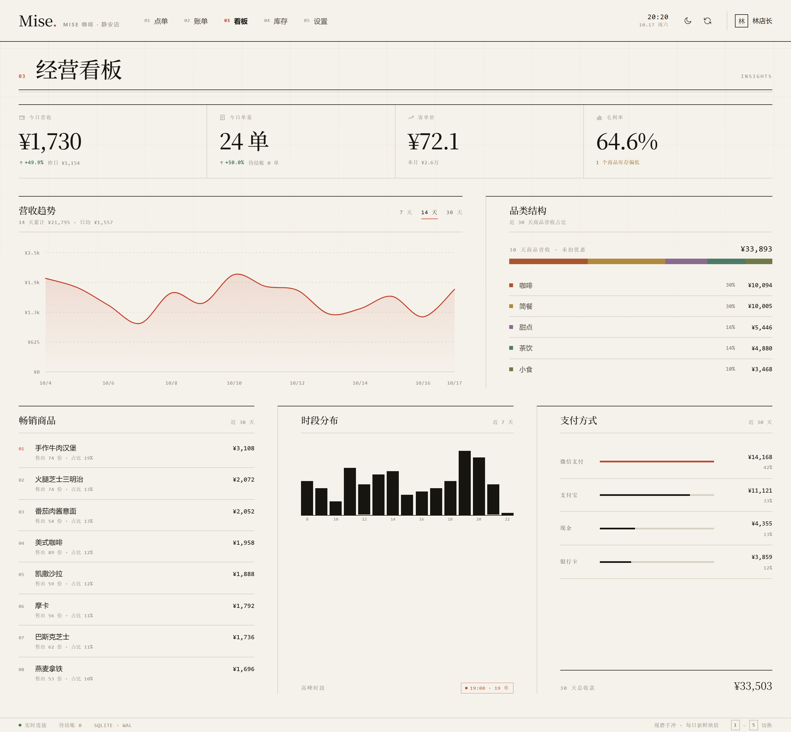
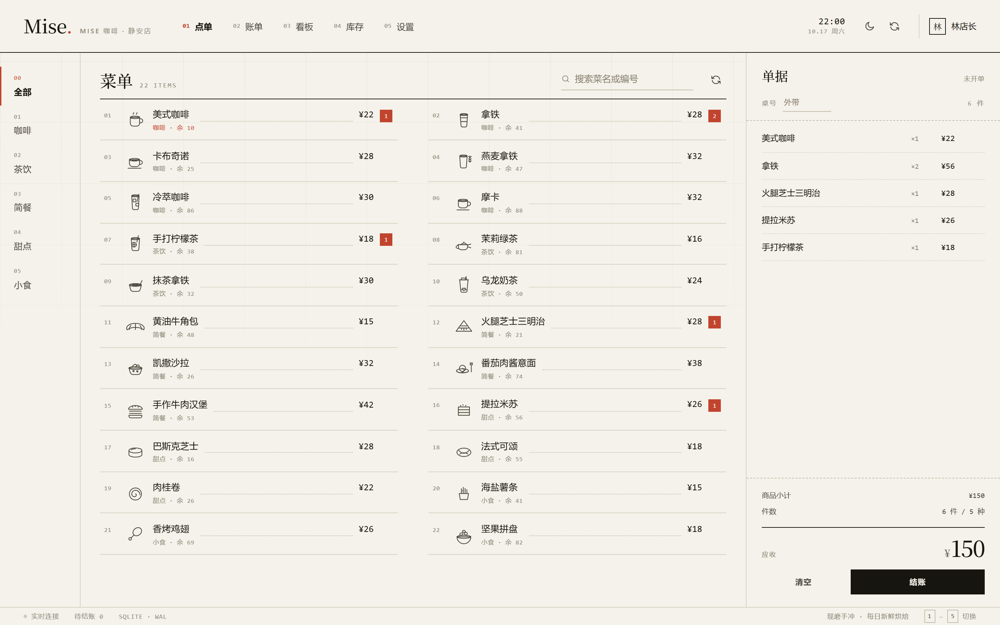
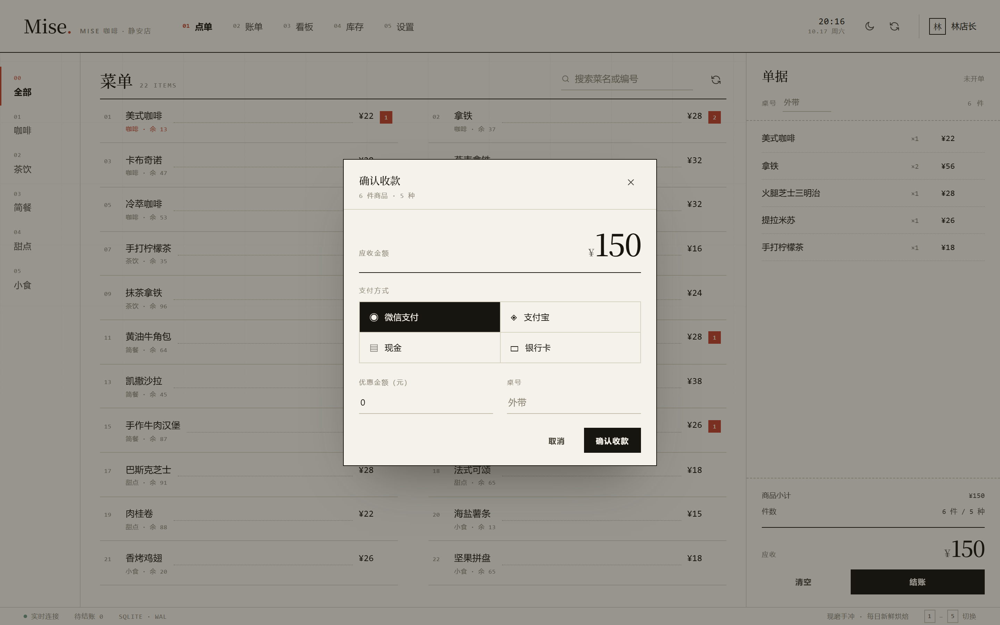
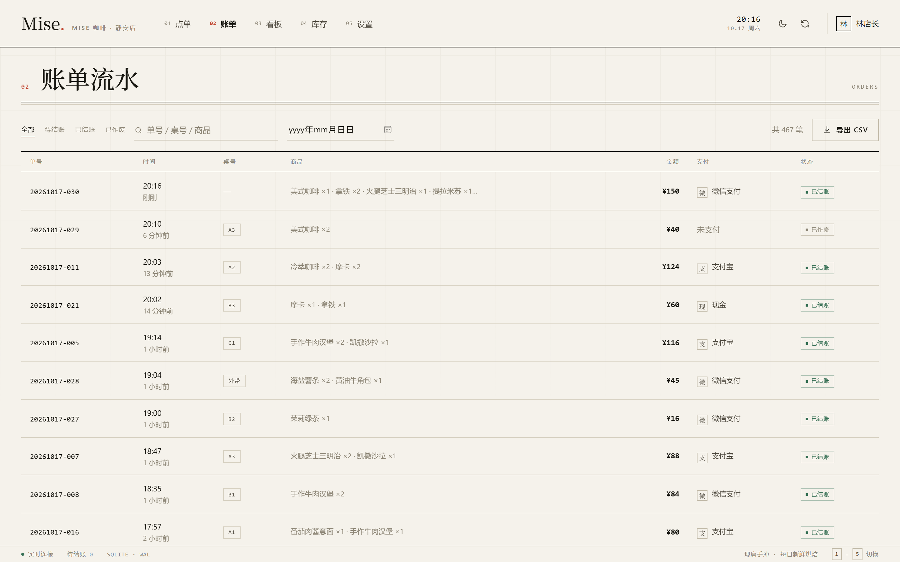
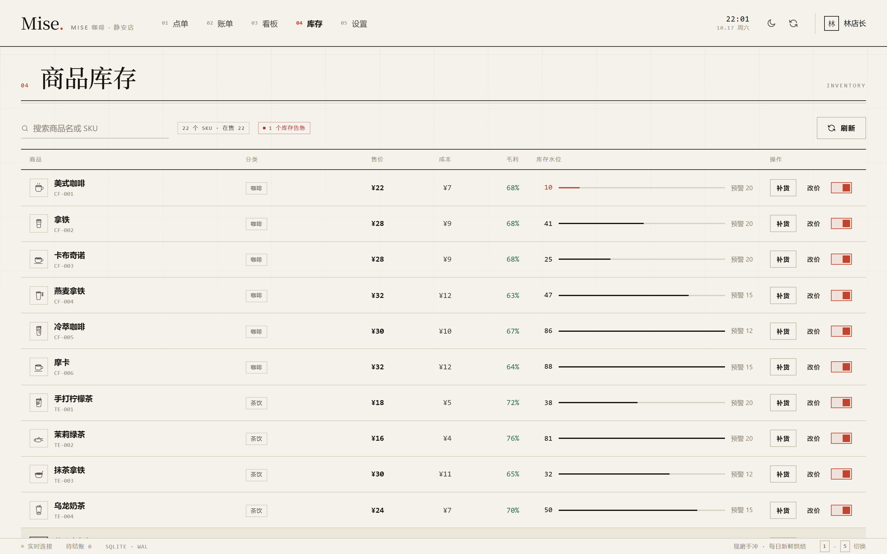

# Mise · 轻量门店经营系统

> 一套给独立小店用的点单 / 收银 / 库存 / 经营分析系统。Express + SQLite + 原生前端，**零构建、零外部服务、一条命令跑起来**。

[](./.github/workflows/ci.yml)
[](./LICENSE)
[](https://nodejs.org)



---

## 为什么做这个

小店的日常其实就四件事：**点单、收钱、盘货、看账**。市面上的 SaaS 收银系统按年付费、数据在别人服务器上、断网就瘫。这个项目把四件事收进一个本地进程里：

- 数据只存在本机一个 `.db` 文件，备份就是复制文件
- 断网可用（除首次 `npm install` 外无任何外网依赖）
- 前后端同源，没有跨域、没有反向代理、没有 Docker

它同时是一份**可读的工程样本**：SQL 事务、视图、窗口函数、JWT、SSE、FLIP 动画、手写 SVG 图表，全部在一万行以内讲清楚。

---

## 界面

| 点单台 | 确认收款 |
| --- | --- |
|  |  |

| 账单流水 | 商品库存 |
| --- | --- |
|  |  |

---

## 设计语言

界面刻意避开「后台模板」的通用语汇（深色卡片、玻璃模糊、渐变按钮、大圆角），改从**纸质菜单与编辑部版面**里取形：

- **底色是纸**：象牙白 `#F5F2EB`，墨色文字 `#16150F`，朱砂红 `#C1442E` 是全站唯一强调色
- **没有圆角、没有投影、没有模糊**：所有层级只靠 `1px` 细线与留白区分
- **三套字体各司其职**：宋体做标题与金额（有印刷感），等宽体做编号、SKU、时间，无衬线体做正文
- **点线引导**：菜名与价格之间用 `dotted leader` 对齐，直接来自纸质菜单的排版习惯
- **商品插图是线描，不是照片**：22 个商品各有一枚手绘单色 SVG，统一 48×48 视框、`currentColor` 描边。彩色食物图会把整站的纸张与油墨调性冲掉，线描才配得上这套版面（见 `public/src/art.js`）
- **横向报头 + 底部状态栏**：替代常见的「左侧栏 + 卡片网格」，更像一份报纸而不是一个后台
- **暗色主题不是反色**：纸 → 墨，朱砂红保持不变，仍是同一套版面

全部由 `public/styles/tokens.css` 里的设计令牌驱动，改一行变量即可换肤。

---

## 功能

**点单收银**
- 分类 / 关键词检索，售罄商品自动置灰
- 购物车增减、桌号、整单优惠，金额实时重算
- 微信 / 支付宝 / 现金 / 银行卡四种支付方式
- 下单即锁库存，作废自动回补，账实始终一致

**经营分析**
- 今日营收 / 单量 / 客单价 / 毛利率，同比昨日与近 7 天环比
- 14 天营收趋势（可切 7 / 30 天）、品类结构堆叠占比条、时段分布、支付方式占比
- 畅销商品 Top 8、低库存预警

**商品库存**
- 改价 / 补货 / 上下架，全部留痕到 `inventory_logs`
- 库存水位条 + 预警阈值，低于阈值标红
- 改价只影响之后的订单，历史账单保留成交价快照

**其他**
- 店长 / 收银员两种角色，写操作按角色鉴权
- SSE 实时推送新订单、支付、库存预警
- 账单 CSV 导出（带 BOM，Excel 直接打开不乱码）
- 暗 / 亮双主题，全站键盘快捷键

---

## 技术栈

| 层 | 选型 | 说明 |
| --- | --- | --- |
| 运行时 | Node.js ≥ 18 | 无 TypeScript 编译、无打包步骤 |
| Web | Express 4 | 只做路由与中间件，业务逻辑在路由工厂里 |
| 数据库 | SQLite（better-sqlite3） | WAL 模式，同步 API，事务简单可靠 |
| 鉴权 | 手写 HS256 JWT + scrypt | 仅用 `node:crypto`，无 jsonwebtoken / bcrypt |
| 实时 | Server-Sent Events | 单向推送足够，自动重连，比 WebSocket 省事 |
| 前端 | 原生 ES Modules | 自研 60 行 store + hash 路由，零依赖 |
| 图表 | 手写 SVG | Catmull-Rom 转贝塞尔，样式跟随 CSS 变量 |
| 动效 | CSS + WAAPI | View Transitions、FLIP、描边绘制、遮罩上滑 |

生产依赖只有两个：`express`、`better-sqlite3`。

---

## 快速开始

```bash
git clone https://github.com/yourname/mise-pos.git
cd mise-pos
npm install
npm start
```

打开 <http://localhost:3000>，用演示账号登录：

| 账号 | 密码 | 角色 |
| --- | --- | --- |
| `owner` | `123456` | 店长（可改价、补货、改门店信息） |
| `cashier` | `123456` | 收银员（只能点单收银） |

首次启动会自动建库、灌入 22 个商品，并生成 **21 天演示订单**（约 450 单），所以看板一打开就有真实曲线，不是空图表。

```bash
npm run dev      # 文件变更自动重启
npm test         # 26 个 API 集成测试
npm run db:reset # 删除本地数据库并重建（会重新生成演示数据）
```

> 想换端口：`PORT=8080 npm start`；想换数据库位置：`DB_FILE=./data/shop.db npm start`。

---

## 目录结构

```
mise-pos/
├── server/
│   ├── index.js          # 进程入口、优雅关闭
│   ├── app.js            # 组装 Express（与监听解耦，便于测试）
│   ├── db.js             # 连接、建表、初始化数据
│   ├── auth.js           # scrypt 哈希 + 手写 JWT
│   ├── events.js         # SSE 广播中枢
│   ├── middleware.js     # 鉴权 / 日志 / 错误处理
│   ├── demo-data.js      # 21 天演示订单生成
│   ├── routes/           # auth · menu · orders · stats · settings
│   └── sql/
│       ├── schema.sql    # 表、索引、视图
│       └── seed.sql      # 分类与商品
├── public/
│   ├── index.html
│   ├── styles/           # tokens · base · components · animations · views
│   └── src/
│       ├── main.js       # 外壳、路由、SSE、快捷键
│       ├── api.js        # 接口封装 + 401 处理
│       ├── store.js      # 响应式状态与购物车
│       ├── charts.js     # 手写 SVG 图表
│       ├── art.js        # 商品线描插图（22 个图形 + 分类兜底）
│       ├── icons.js      # 界面图标
│       ├── format.js     # 金额、支付方式等展示元数据
│       ├── ui.js         # toast / modal / drawer / FLIP / 涟漪
│       └── views/        # login · pos · orders · dashboard · inventory · settings
├── tests/api.test.js
└── docs/screenshots/
```

---

## 数据库设计

7 张表、2 个视图、6 个索引。完整定义见 [`server/sql/schema.sql`](server/sql/schema.sql)。

```sql
users(id, username, password, display_name, role)
categories(id, name, color, sort_order)
products(id, sku, name, category_id→categories, price_cents, cost_cents,
         stock, low_stock, unit, emoji, is_active)
orders(id, order_no, table_no, status, subtotal_cents, discount_cents,
       total_cents, payment_method, cashier_id→users, note, created_at, paid_at)
order_items(id, order_id→orders, product_id→products, name_snapshot,
            unit_price_cents, qty, line_total_cents)
inventory_logs(id, product_id→products, delta, balance, reason, order_id, operator_id)
settings(key, value)
```

四个刻意的设计决定：

**1. 金额一律存「分」**
`INTEGER` 存分，前端只做展示层除法。SQLite 没有 `DECIMAL`，用 `REAL` 存钱迟早出现 `0.1 + 0.2 = 0.30000000000000004`。

**2. 订单明细做价格快照**
`order_items` 冗余存 `name_snapshot` 与 `unit_price_cents`，而不是只留 `product_id`。商品改价、改名之后，历史账单必须还是当时的样子——这是收银系统的硬要求，也是反范式设计的正当理由。

**3. 库存只能通过流水追溯**
每次库存变化都写一条 `inventory_logs`，并记录变更后的 `balance`。对账时不必重算全表，直接看最后一条余额即可。

**4. 报表口径收口在视图**
「营业日」按本地时区切分，凌晨的订单不能串到前一天：

```sql
CREATE VIEW v_paid_orders AS
SELECT o.*, date(o.paid_at, 'localtime') AS biz_date,
       strftime('%H', o.paid_at, 'localtime') AS biz_hour
FROM orders o WHERE o.status = 'paid';
```

趋势图的日期补零用递归 CTE，环比用窗口函数 `LAG`，应用层不做任何聚合：

```sql
WITH RECURSIVE seq(d) AS (
  SELECT date('now','localtime','-13 day')
  UNION ALL SELECT date(d,'+1 day') FROM seq WHERE d < date('now','localtime')
)
SELECT s.d AS day,
       COALESCE(v.revenue_cents, 0) AS revenue,
       COALESCE(LAG(v.revenue_cents) OVER (ORDER BY s.d), 0) AS prevRevenue
FROM seq s LEFT JOIN v_daily_sales v ON v.day = s.d
ORDER BY s.d;
```

---

## 一致性：下单与作废

下单不是四次独立写入，而是一个事务：

```js
const createTx = db.transaction((payload) => {
  // 1. 服务端重新计价，不信任前端传来的金额
  // 2. 写订单头
  // 3. 写明细 + 原子扣库存
  const result = decStock.run(qty, productId, qty);
  if (result.changes === 0) throw conflict('库存不足', 'OUT_OF_STOCK');
  // 4. 写库存流水
});
```

关键在扣库存的 SQL：

```sql
UPDATE products SET stock = stock - ? WHERE id = ? AND stock >= ?;
```

把「判断够不够」和「扣减」合成一条语句，靠 `changes === 0` 判断失败。这样即使两个收银台同时下最后一杯，也只有一个能成功，不需要先 `SELECT` 再 `UPDATE` 的竞态窗口。任一步抛错，better-sqlite3 会整体回滚——不会出现「订单写进去了但库存没扣」的脏数据。

作废则按流水原路回补，并写 `reason = 'void'` 的日志。

---

## API

所有接口返回统一信封：`{ ok: true, data }` / `{ ok: false, error: { code, message } }`。

令牌只走 `Authorization: Bearer`，只有 `/api/events` 例外（`EventSource` 无法设置请求头）。登录失败 5 次锁 5 分钟，账号不存在时也会跑一次 scrypt，避免用响应时间探测账号。

| 方法 | 路径 | 说明 |
| --- | --- | --- |
| POST | `/api/auth/login` | 登录，返回 JWT（12h） |
| GET | `/api/auth/me` | 当前用户 |
| GET | `/api/menu` | 分类 + 商品（含库存） |
| PATCH | `/api/menu/products/:id` | 改价 / 上下架（店长） |
| POST | `/api/menu/products/:id/restock` | 补货（店长） |
| POST | `/api/orders` | 下单（事务扣库存） |
| GET | `/api/orders` | 列表，支持 `status` / `date` / `q` / 分页 |
| GET | `/api/orders/:id` | 详情 + 明细 + 库存流水 |
| POST | `/api/orders/:id/pay` | 收款 |
| POST | `/api/orders/:id/void` | 作废并回补库存 |
| GET | `/api/orders/export.csv` | 导出 CSV（沿用列表的 `status` / `date` / `q`） |
| GET | `/api/stats/overview` | 今日 / 昨日 / 本月 KPI |
| GET | `/api/stats/series?days=14` | 营收趋势 |
| GET | `/api/stats/top` | 畅销商品 |
| GET | `/api/stats/categories` | 品类结构 |
| GET | `/api/stats/hourly` | 时段分布 |
| GET | `/api/stats/payments` | 支付方式占比 |
| GET | `/api/settings` | 门店资料 |
| PUT | `/api/settings` | 保存门店资料（店长） |
| GET | `/api/events` | SSE 事件流（`?token=` 传令牌） |
| GET | `/api/health` | 健康检查（无需鉴权） |

```bash
TOKEN=$(curl -s -X POST localhost:3000/api/auth/login \
  -H 'Content-Type: application/json' \
  -d '{"username":"owner","password":"123456"}' | jq -r .data.token)

curl -s localhost:3000/api/stats/overview -H "Authorization: Bearer $TOKEN" | jq
```

---

## 前端动效

没有引入任何动画库，全部落在 CSS 与 Web Animations API：

| 场景 | 实现 |
| --- | --- |
| 页面切换 | `document.startViewTransition` + `::view-transition-*`，不支持时降级为 fade-up |
| 加入购物车 | 条目以 `print-in` 逐行「打印」进小票：`clip-path` 由上往下揭示 |
| 购物车重排 | FLIP：记录首末位置，反推 `translate` 后回放 |
| 金额变化 | `requestAnimationFrame` + easeOutCubic 数字滚动 |
| 图表入场 | `stroke-dashoffset` 描边绘制，柱状图 `scaleY` 逐条生长 |
| 列表入场 | IntersectionObserver + `--i` 变量做 stagger |
| 报头导航 | 编号 + 朱砂红下划线，`scaleX` 自左展开；编号先变红再变字色 |
| 标题入场 | `mask-up`：`clip-path` 遮罩内整体上滑，模拟活字上版 |
| 按钮 | 指针位置计算涟漪；主按钮 `::before` 自下往上填充扫过 |
| 按钮按下 | `:active` 轻微下压，`transition` 用 spring 曲线 |

全站遵循 `prefers-reduced-motion`：系统开启「减少动态效果」后，所有动画降到 0.001ms，功能不受影响。

---

## 测试

```bash
npm test
```

26 个集成测试跑在**内存数据库**上，通过真实 HTTP 请求验证：

- 登录成功 / 密码错误 / 无令牌 / 伪造签名 / 连续失败限流
- 服务端重新计价（前端传 `price: 1` 会被忽略）
- 优惠金额超过小计时被夹到小计，实收不会为负
- 下单扣库存；库存不足时整单回滚且库存不变
- 同一商品拆成两行也守 99 件上限
- 重复支付被拒绝
- 作废回补库存、写入流水、不计入营收
- 补货拒绝负数，流水 `delta` 与库存变化一致
- 单日流水号超过 999 后仍然唯一
- 趋势图按天补零、非法参数返回 400、营业时段外的订单不被丢弃
- CSV 导出遵循当前筛选条件
- 普通接口不接受 query 里的令牌，只有 SSE 例外
- 收银员改价返回 403

---

## 部署

单进程，无需 Nginx 也能跑：

```bash
NODE_ENV=production PORT=3000 JWT_SECRET=$(openssl rand -hex 32) npm start
```

用 systemd 常驻：

```ini
[Unit]
Description=Mise POS
After=network.target

[Service]
WorkingDirectory=/opt/mise-pos
ExecStart=/usr/bin/node server/index.js
Environment=NODE_ENV=production PORT=3000
Restart=always
User=mise

[Install]
WantedBy=multi-user.target
```

数据库默认在 `data/mise.db`，定时 `cp` 这个文件就是完整备份。

**上线前必做**：设置 `JWT_SECRET` 环境变量（默认值仅用于开发），并修改演示账号密码。

---

## 快捷键

| 键 | 功能 |
| --- | --- |
| `1` – `5` | 点单台 / 账单 / 看板 / 库存 / 设置 |
| `Esc` | 关闭弹窗或抽屉 |

---

## Roadmap

- [ ] 多门店与员工排班
- [ ] 会员储值与积分
- [ ] 小票热敏打印（ESC/POS）
- [ ] 离线队列：断网时本地排队，恢复后同步

---

## License

[MIT](./LICENSE)
